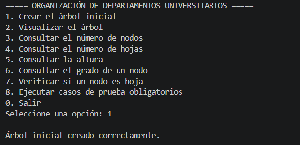
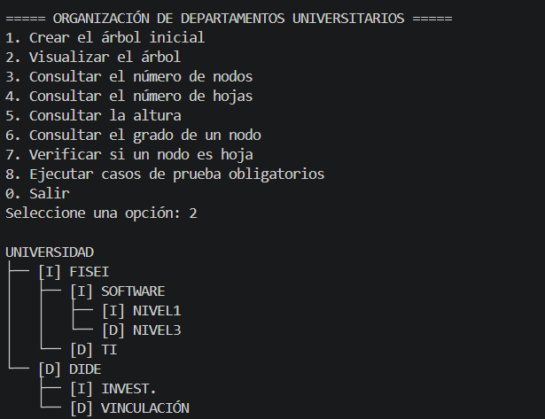
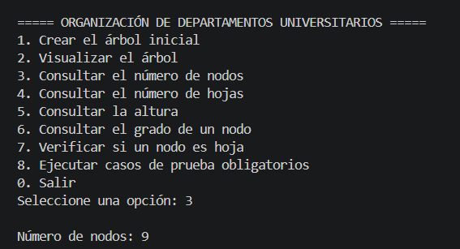
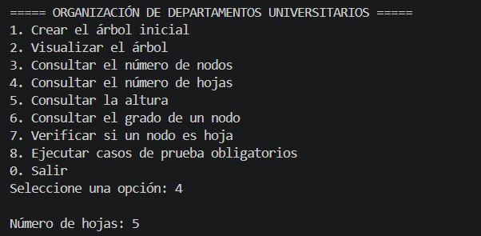
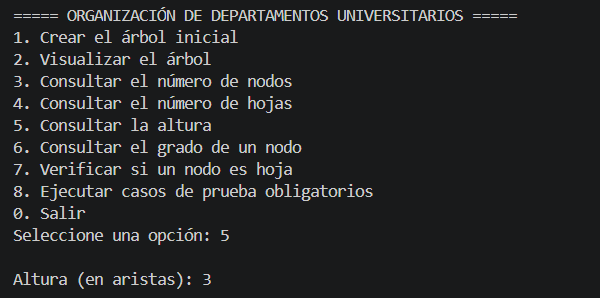
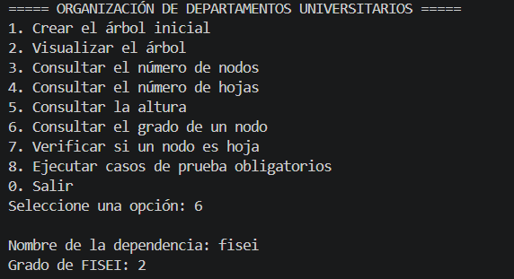
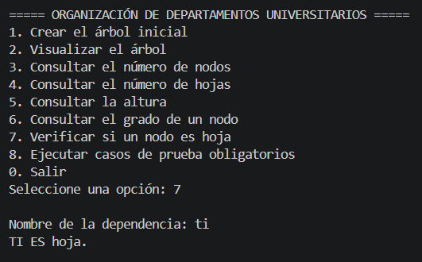
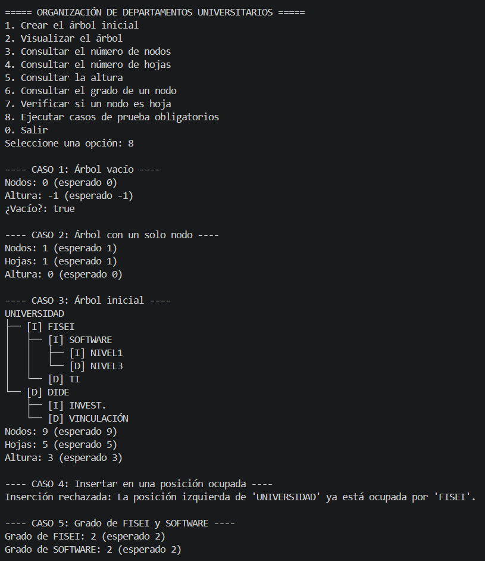

# T6-ArbolBinario-ApellidoNombre

**Asignatura:** Estructura de Datos · **Nivel:** Tercero – Ingeniería de Software
**Autor:** Nombre Apellido

## 1. Problema
La Universidad necesita representar la organización de sus dependencias académicas mediante un
árbol binario. Cada nodo guarda el nombre de una dependencia y tiene como máximo dos hijos.

## 2. Estructura del árbol
```
UNIVERSIDAD
├── [I] FISEI
│   ├── [I] SOFTWARE
│   │   ├── [I] NIVEL1
│   │   └── [D] NIVEL3
│   └── [D] TI
└── [D] DIDE
    ├── [I] INVEST.
    └── [D] VINCULACIÓN
```
9 nodos · 5 hojas · altura 3 (en aristas).

## 3. Organización del proyecto
```
src/
 ├── modelo/Nodo.java
 ├── negocio/ArbolBinario.java
 └── app/Main.java
```
Conteo de nodos, conteo de hojas y altura implementados con **recursividad**.
No se usan TreeSet, TreeMap, PriorityQueue, NavigableSet ni NavigableMap.


## 4. Resultados
| Caso de prueba | Esperado | Obtenido |
|---|---|---|
| Árbol vacío | 0 nodos, altura -1 | 0 nodos, altura -1, árbol vacío: true |
| Un solo nodo | 1 hoja, altura 0 | 1 nodo, 1 hoja, altura 0 |
| Árbol inicial | 9 nodos, 5 hojas, altura 3 | 9 nodos, 5 hojas, altura 3 |
| Insertar en posición ocupada | Se rechaza |  Rechazada: “La posición izquierda de ‘UNIVERSIDAD’ ya está ocupada por ‘FISEI’” |
| Grado de FISEI y SOFTWARE | 2 y 2 |FISEI: 2, SOFTWARE: 2 |


## Capturas de ejecución

### 1. Crear el árbol inicial


### 2. Visualizar el árbol


### 3. Número de nodos


### 4. Número de hojas


### 5. Altura


### 6. Grado de un nodo


### 7. Verificar si un nodo es hoja


### 8. Casos de prueba obligatorios



